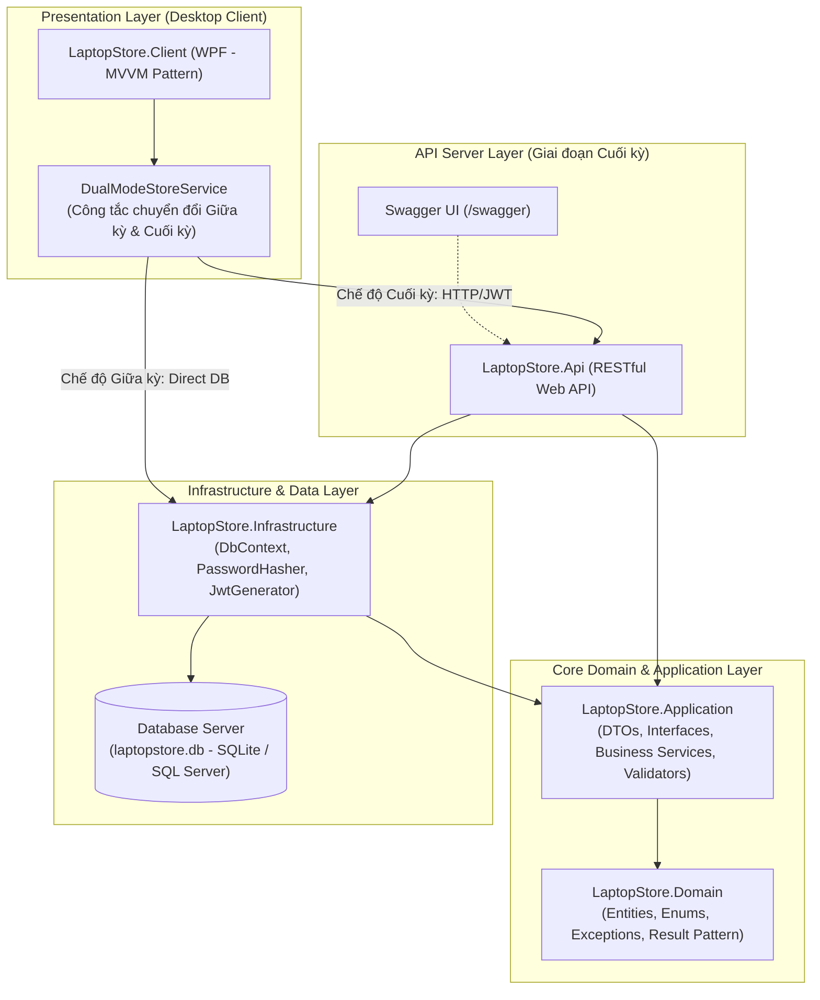

# ⚡ TECHGEAR LAPTOP STORE — HỆ THỐNG QUẢN LÝ VÀ BÁN HÀNG LAPTOP & THIẾT BỊ CÔNG NGHỆ

> **Đồ án môn học:** Ứng dụng Quản lý 2 (UDQL2 2026) / Lập trình Desktop  
> **Sinh viên thực hiện:**  
> - 23120068: Lê Nguyễn Minh Nhật  
> - 23120069: Nguyễn Trần Quỳnh Như  
> - 23210078: Đặng Mai Quốc  
> **Chủ đề cửa hàng:** Cửa hàng bán laptop hoặc phần cứng máy tính (Số cuối MSSV = 8)  
> **Nền tảng:** .NET 8 / C# 12 / WPF Desktop / ASP.NET Core Web API / EF Core  
> **Git Branches:** `main` & `feature/midterm-progress-completion`  

---

## 📑 MỤC LỤC
1. [Giới thiệu dự án & Lộ trình phát triển](#1-giới-thiệu-dự-án--lộ-trình-phát-triển)
2. [Danh sách chức năng nghiệp vụ (Hoàn thành 100%)](#2-danh-sách-chức-năng-nghiệp-vụ-hoàn-thành-100)
3. [Kiến trúc hệ thống 2 giai đoạn (Giữa kỳ & Cuối kỳ)](#3-kiến-trúc-hệ-thống-2-giai-đoạn-giữa-kỳ--cuối-kỳ)
4. [Công nghệ sử dụng](#4-công-nghệ-sử-dụng)
5. [Tài khoản demo & Phân quyền (RBAC)](#5-tài-khoản-demo--phân-quyền-rbac)
6. [Dữ liệu demo sẵn có](#6-dữ-liệu-demo-sẵn-có)
7. [Tích hợp Trợ lý AI Thông minh](#7-tích-hợp-trợ-lý-ai-thông-minh)
8. [Hướng dẫn cài đặt & Khởi chạy](#8-hướng-dẫn-cài-đặt--khởi-chạy)
9. [Kiểm thử chất lượng phần mềm](#9-kiểm-thử-chất-lượng-phần-mềm)
10. [Lịch sử phát triển Git & Quá trình thực hiện](#10-lịch-sử-phát-triển-git--quá-trình-thực-hiện)

---

## 1. Giới thiệu dự án & Lộ trình phát triển

**TechGear Laptop Store** là giải pháp phần mềm quản lý và kinh doanh bán hàng chuyên nghiệp dành riêng cho các cửa hàng laptop và thiết bị phần cứng công nghệ (ASUS ROG, Dell XPS, MacBook Pro, Lenovo Legion, HP, RAM DDR5 Kingston, SSD Samsung 990 Pro, VGA RTX 4070...).

Hệ thống được thiết kế theo chuẩn **Clean Architecture**, đáp ứng đầy đủ và vượt mức cả 2 giai đoạn yêu cầu của đề bài:

- **Giai đoạn 1 (Báo cáo tiến độ - Giữa kỳ: 3.5 điểm):**
  - **Mô hình kiến trúc:** Ứng dụng Desktop ➔ Database Server (kết nối trực tiếp cơ sở dữ liệu).
  - Hoạt động độc lập không cần bật Web API.
  - Quản trị viên thực hiện toàn diện các nghiệp vụ: CRUD sản phẩm (kèm thông số cấu hình CPU, RAM, GPU, SSD), CRUD danh mục, CRUD khách hàng, Lập đơn hàng bán lẻ POS, Kiểm tra tồn kho thời gian thực, Theo dõi trạng thái đơn hàng và Báo cáo thống kê.
- **Giai đoạn 2 (Hoàn thiện - Cuối kỳ: 4.5 điểm):**
  - **Mô hình kiến trúc:** Client ➔ API Server ➔ Database Server (Client không truy cập trực tiếp DB mà qua RESTful API).
  - Xác thực bảo mật **PBKDF2 Salted Hash** và **JWT Bearer Token**.
  - Phân quyền theo vai trò **RBAC** 4 nhóm (Admin, Manager, SalesStaff, WarehouseStaff).
  - Tích hợp **AI Agent thông minh** có Tool calling và tuân thủ phân quyền người dùng.

> 💡 **Tính năng nổi bật:** Ứng dụng Desktop hỗ trợ nút chuyển đổi tức thì giữa **Chế độ Giữa kỳ (Direct Database)** và **Chế độ Cuối kỳ (Web API)** ngay trên thanh tiêu đề Header!

---

## 2. Danh sách chức năng nghiệp vụ (Hoàn thành 100%)

### 💻 Quản lý Sản phẩm (Laptop & Linh kiện phần cứng)
- **CRUD toàn diện:**
  - **Thêm sản phẩm mới:** Dialog nhập liệu đầy đủ thông tin: Tên, Mã SKU, Hãng sản xuất, Model, Giá bán, Giá vốn, Số lượng tồn, Ngưỡng cảnh báo tồn tối thiểu, Thời hạn bảo hành.
  - **Quản lý cấu hình phần cứng chi tiết:** CPU, RAM, Ổ cứng SSD, Card đồ họa GPU, Màn hình, Hệ điều hành, Mô tả tóm tắt.
  - **Chỉnh sửa sản phẩm:** Cập nhật thông số kỹ thuật, giá niêm yết, số lượng tồn kho.
  - **Xóa sản phẩm:** Xóa an toàn kèm hộp thoại xác nhận.
- **Tìm kiếm & Bộ lọc thông minh:** Tìm kiếm thời gian thực theo Tên, SKU, Hãng sản xuất, CPU, GPU; Lọc sản phẩm theo từng Danh mục.
- **Xem chi tiết:** Panel xem chi tiết cấu hình máy bay lượn trực quan.

### 📁 Quản lý Danh mục Sản phẩm
- Màn hình quản lý danh mục riêng biệt với đầy đủ thao tác:
  - Thêm mới danh mục sản phẩm (Tên, Thứ tự hiển thị, Mô tả).
  - Chỉnh sửa thông tin danh mục.
  - Xóa danh mục (Tự động kiểm tra ràng buộc, cảnh báo nếu danh mục đang chứa sản phẩm).
  - Hiển thị số lượng sản phẩm / máy đang kinh doanh thuộc mỗi nhóm danh mục.

### 👥 Quản lý Khách hàng & Điểm thưởng thành viên
- Màn hình quản lý hồ sơ khách hàng:
  - Thêm mới khách hàng (Họ tên, Số điện thoại, Email, Địa chỉ giao hàng, Ghi chú).
  - Chỉnh sửa thông tin khách hàng.
  - Xóa khách hàng (Chặn xóa nếu khách hàng đã phát sinh đơn hàng lịch sử).
  - Tìm kiếm khách hàng đa tiêu chí theo Tên hoặc Số điện thoại.
  - Tự động tích lũy tổng chi tiêu và điểm thưởng thành viên (`RewardPoints`).
  - **Theo dõi lịch sử mua hàng:** Bảng danh sách tất cả các đơn hàng đã mua của khách hàng được chọn.

### 🧾 Lập & Quản lý Đơn hàng (POS & Order Tracking)
- **Dialog Lập đơn hàng mới tại quầy (Point of Sale):**
  - Chọn khách hàng từ danh bạ (hoặc khách vãng lai).
  - Chọn laptop / linh kiện máy tính từ danh mục sản phẩm.
  - Nhập số lượng mua ➔ **Kiểm tra tồn kho thời gian thực** (Test case Order-02: Nếu mua quá số lượng tồn kho khả dụng ➔ Hệ thống lập tức cảnh báo và từ chối thêm vào đơn).
  - Bảng giỏ hàng tạm thời: SKU, Tên sản phẩm, Đơn giá, Số lượng, Thành tiền, nút Xóa khỏi giỏ.
  - Áp dụng chiết khấu / Giảm giá (VNĐ).
  - Tự động tính toán: Tổng tiền hàng, Giảm giá, Tiền khách cần trả.
  - Chọn phương thức thanh toán (Tiền mặt, Chuyển khoản...).
  - Lưu đơn hàng và **tự động trừ tồn kho** trong Database Transaction an toàn.
- **Quản lý vòng đời đơn hàng:**
  - Bảng danh sách đơn hàng với đầy đủ thông tin: Mã đơn, Khách hàng, SĐT, Tổng tiền, Giảm giá, Thành tiền, Trạng thái, Phương thức thanh toán, Ngày tạo.
  - **Xem chi tiết đơn hàng:** Xem toàn bộ danh sách sản phẩm, số lượng và đơn giá bên trong từng đơn hàng.
  - **Cập nhật trạng thái:** Nút chuyển đổi nhanh sang `Đang Xử Lý` (Processing), `Hoàn Thành` (Completed).
  - **Hủy đơn hàng:** Tự động hoàn trả số lượng hàng vào kho (`StockQuantity` được cộng ngược lại).

### 📊 Báo cáo & Thống kê Doanh thu (Dashboard)
- Dashboard trực quan hiển thị tổng doanh thu tích lũy, số lượng đơn hoàn tất.
- Danh sách **Top 5 laptop / linh kiện bán chạy nhất**.
- Danh sách cảnh báo sản phẩm sắp hết hàng cần nhập bổ sung.

### 🤖 Trợ lý AI Nghiệp vụ Thông minh
- Tích hợp mô hình AI kết hợp Tool Execution truy vấn dữ liệu thực tế:
  - AI phân tích doanh thu, sản phẩm bán chạy, tồn kho thấp.
  - Tư vấn laptop phù hợp cho khách theo ngân sách và nhu cầu (chơi game, văn phòng, lập trình...).
  - **Tuân thủ phân quyền RBAC:** AI từ chối nhân viên (`SalesStaff`) khi hỏi số liệu doanh thu toàn hệ thống; chấp thuận và lập báo cáo chi tiết cho Quản lý (`Manager`) và `Admin`.

---

## 3. Kiến trúc hệ thống 2 giai đoạn (Giữa kỳ & Cuối kỳ)

Hệ thống được thiết kế theo chuẩn Clean Architecture và hỗ trợ cả 2 giai đoạn:

```
[Chế độ Giữa kỳ] : Desktop Client ➔ Database Server (SQLite / SQL Server)
[Chế độ Cuối kỳ] : Desktop Client ➔ ASP.NET Core Web API ➔ Database Server
```



---

## 4. Công nghệ sử dụng

- **Ngôn ngữ:** C# 12 / 13 (.NET 8 LTS)
- **Desktop UI Framework:** WPF (Windows Presentation Foundation) với kiến trúc MVVM (`CommunityToolkit.Mvvm`).
- **Backend API:** ASP.NET Core Web API 8.0 / 9.0.
- **ORM & CSDL:** Entity Framework Core 8.0, mặc định sử dụng **SQLite** (`laptopstore.db` - tự động tạo và seed data) và hỗ trợ **Microsoft SQL Server**.
- **Bảo mật & Xác thực:** PBKDF2 Salted Hash và JWT Bearer Token.
- **Tài liệu API:** Swagger UI / OpenAPI hỗ trợ nhập Bearer Token.
- **Kiểm thử tự động:** xUnit Testing Framework, EF Core InMemory.

---

## 5. Tài khoản demo & Phân quyền (RBAC)

Hệ thống cung cấp sẵn **4 tài khoản demo** đại diện cho 4 vai trò (hỗ trợ nút đăng nhập 1-click trên thanh tiêu đề):

| Tài khoản | Mật khẩu | Vai trò (Role) | Quyền hạn và phạm vi nghiệp vụ |
| :--- | :--- | :--- | :--- |
| `admin` | `Admin@123` | **Admin** | Quản trị toàn hệ thống: sản phẩm, danh mục, khách hàng, đơn hàng, báo cáo tài chính, phân quyền. |
| `manager` | `Manager@123` | **Manager** | Quản lý vận hành: xem báo cáo doanh thu, duyệt/hủy đơn hàng, hỏi AI về số liệu kinh doanh. |
| `staff` | `Staff@123` | **SalesStaff** | Nhân viên bán hàng: tra cứu sản phẩm, tạo đơn hàng POS, quản lý khách hàng (chặn xem doanh thu). |
| `warehouse` | `Warehouse@123` | **WarehouseStaff** | Quản lý kho: kiểm kê tồn kho, cập nhật số lượng, xem danh sách máy sắp hết hàng. |

---

## 6. Dữ liệu demo sẵn có

Bộ nạp dữ liệu mẫu (`DbInitializer`) tự động khởi tạo khi ứng dụng chạy lần đầu:
- ✅ **24 sản phẩm laptop và linh kiện phần cứng thực tế** (ROG Zephyrus G16, MacBook Pro M3, XPS 15, Legion Pro 5, RAM Kingston Fury, SSD Samsung 990 Pro, RTX 4070 Ti Super...) đầy đủ thông số kỹ thuật, giá vốn, giá niêm yết, số lượng tồn kho.
- ✅ **5 danh mục sản phẩm**: Laptop Gaming, Laptop Văn Phòng, Laptop Đồ Họa, Linh Kiện Máy Tính, Phụ Kiện Laptop.
- ✅ **12 khách hàng thực tế** kèm số điện thoại, địa chỉ, tổng chi tiêu và điểm thưởng.
- ✅ **22 đơn hàng mẫu** trải dài nhiều trạng thái (`Completed`, `Processing`, `Shipping`, `Pending`, `Cancelled`).
- ✅ **4 tài khoản người dùng** tương ứng 4 vai trò demo.

---

## 7. Tích hợp Trợ lý AI Thông minh

Module AI Assistant (`/api/ai/ask` hoặc tab AI trên Client):
1. **Truy vấn CSDL thực tế:** AI gọi các Tool nghiệp vụ (`get_sales_report`, `get_low_stock_products`, `search_products_by_requirement`).
2. **Kiểm soát phân quyền RBAC:** Nhân viên bán hàng hỏi doanh thu toàn hệ thống ➔ AI từ chối; Quản lý/Admin hỏi ➔ AI tính toán và lập báo cáo.
3. **Tư vấn sản phẩm thông minh:** Tìm kiếm laptop phù hợp dựa trên database theo ngân sách và nhu cầu của khách hàng.

---

## 8. Hướng dẫn cài đặt & Khởi chạy

### Yêu cầu môi trường
- Hệ điều hành: Windows 10/11
- .NET 8.0 SDK trở lên

### Cách 1: Khởi chạy Chế độ Giữa kỳ (Ứng dụng ➔ Database Server)
Chỉ cần chạy Desktop Client trực tiếp (không cần bật API Server):
```powershell
cd src/LaptopStore.Client
dotnet run
```
*Database SQLite và 100% dữ liệu demo sẽ tự động được tạo lập sẵn.*

### Cách 2: Khởi chạy Chế độ Cuối kỳ (Client ➔ API Server ➔ Database Server)
Mở 2 cửa sổ terminal:
- **Terminal 1 (Chạy API Server):**
  ```powershell
  cd src/LaptopStore.Api
  dotnet run
  ```
  *(Truy cập Swagger tại `http://localhost:5000/swagger`)*

- **Terminal 2 (Chạy Desktop Client):**
  ```powershell
  cd src/LaptopStore.Client
  dotnet run
  ```
  *Bấm nút "🔄 Kiến Trúc" trên thanh tiêu đề để chuyển sang chế độ API Server.*

---

## 9. Kiểm thử chất lượng phần mềm

Chạy toàn bộ 12 test case tự động:
```powershell
dotnet test
```
**Kết quả:** `Passed! - Failed: 0, Passed: 12, Skipped: 0, Total: 12 (100% Pass)`.

---

## 10. Lịch sử phát triển Git & Quá trình thực hiện

Mã nguồn được tổ chức commit theo từng tính năng thể hiện rõ quá trình phát triển:
1. `feat: initial project structure and domain models`
2. `feat: implement application layer with DTOs, interfaces and business services`
3. `feat: implement infrastructure layer with EF Core DbContext, Security and rich Seed Data`
4. `feat: implement ASP.NET Core Web API with JWT auth and RBAC`
5. `feat: implement modern desktop client with MVVM architecture`
6. `test: add comprehensive automated unit tests for business logic, RBAC and AI integration`
7. `docs: add comprehensive README, system architecture, database design and test cases`
8. `feat(arch): implement direct database service and dual-mode architecture for midterm compliance`
9. `feat(product): implement full product CRUD dialogs, hardware specs editing and validation`
10. `feat(category): implement full category management CRUD and UI`
11. `feat(customer): implement full customer management CRUD and order history tracking`
12. `feat(order): implement order creation dialog, real-time stock check and status workflow`
13. `feat(ui): integrate categories, customers, and architecture toggle into MainWindow navigation`
