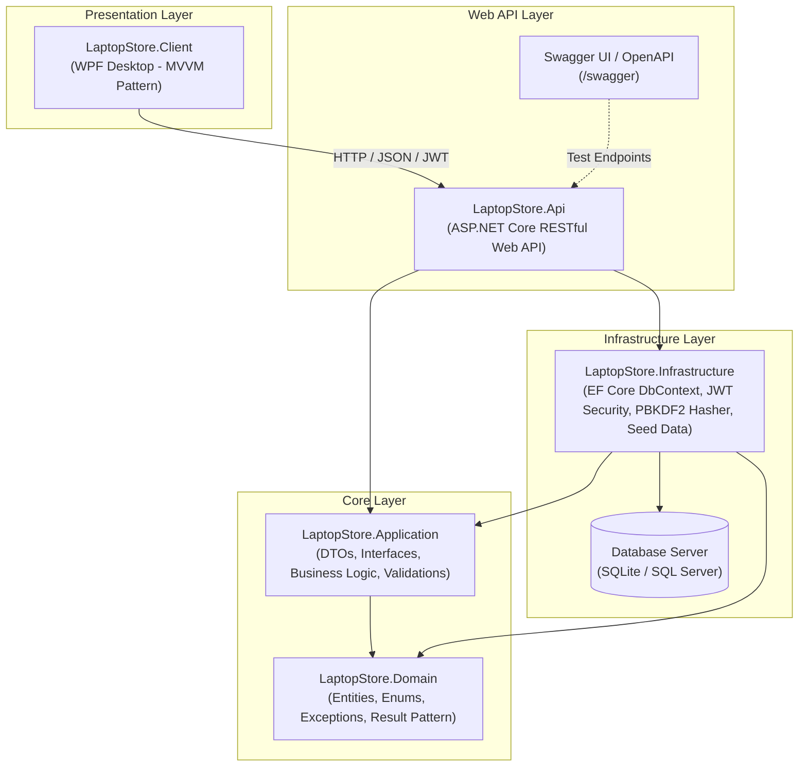

# ⚡ TECHGEAR LAPTOP STORE — HỆ THỐNG QUẢN LÝ VÀ BÁN HÀNG LAPTOP & THIẾT BỊ CÔNG NGHỆ

> **Đồ án môn học:** Ứng dụng Quản lý 2 (UDQL2 2026) / Lập trình Desktop  
> **Sinh viên thực hiện:** 23120078  
> **Chủ đề cửa hàng:** Cửa hàng bán laptop hoặc phần cứng máy tính (Số cuối MSSV = 8)  
> **Nền tảng:** .NET 8 / C# 12 / WPF / ASP.NET Core Web API / EF Core  

---

## 📑 MỤC LỤC
1. [Giới thiệu dự án](#1-giới-thiệu-dự-án)
2. [Danh sách chức năng chính](#2-danh-sách-chức-năng-chính)
3. [Kiến trúc hệ thống](#3-kiến-trúc-hệ-thống)
4. [Công nghệ sử dụng](#4-công-nghệ-sử-dụng)
5. [Tài khoản demo & Phân quyền (RBAC)](#5-tài-khoản-demo--phân-quyền-rbac)
6. [Dữ liệu demo sẵn có](#6-dữ-liệu-demo-sẵn-có)
7. [Tích hợp Trợ lý AI Thông minh](#7-tích-hợp-trợ-lý-ai-thông-minh)
8. [Hướng dẫn cài đặt & Khởi chạy](#8-hướng-dẫn-cài-đặt--khởi-chạy)
9. [Kiểm thử chất lượng phần mềm](#9-kiểm-thử-chất-lượng-phần-mềm)
10. [Lịch sử phát triển Git](#10-lịch-sử-phát-triển-git)

---

## 1. Giới thiệu dự án

**TechGear Laptop Store** là giải pháp phần mềm quản lý và kinh doanh bán hàng chuyên nghiệp dành cho các cửa hàng bán laptop và linh kiện phần cứng máy tính (ASUS, Dell, Apple, Lenovo, MSI, Acer, HP, RAM Kingston, SSD Samsung, VGA NVIDIA RTX...).

Hệ thống được thiết kế theo chuẩn **Clean Architecture**, đáp ứng đầy đủ lộ trình phát triển theo yêu cầu giảng viên:
- **Giai đoạn 1 (Báo cáo tiến độ - Giữa kỳ):** Ứng dụng kết nối trực tiếp CSDL Server, hỗ trợ tài khoản quản trị thực hiện các nghiệp vụ CRUD, quản lý sản phẩm, đơn hàng, khách hàng và thống kê cơ bản.
- **Giai đoạn 2 (Hoàn thiện - Cuối kỳ):** Hệ thống phân tán hoàn chỉnh theo mô hình **Client ➔ API Server ➔ Database Server**. Client không gọi trực tiếp Database mà thông qua RESTful API, có xác thực bảo mật **JWT Bearer**, phân quyền **Role-Based Access Control (RBAC)**, kiểm thử tự động (Unit Test xUnit) và **tích hợp AI Agent** hỗ trợ kinh doanh thực tế.

---

## 2. Danh sách chức năng chính

### 💻 Quản lý Sản phẩm (Laptop & Linh kiện)
- Quản lý đầy đủ danh mục: Laptop Gaming, Ultrabook Mỏng nhẹ, Máy trạm Workstation, Linh kiện phần cứng, Phụ kiện & Gear.
- Thêm, sửa, xóa (soft delete), tìm kiếm thông minh theo tên, SKU, hãng, CPU, GPU, khoảng giá.
- Quản lý thông số kỹ thuật chuyên sâu: CPU, RAM, SSD, GPU, Màn hình, Cân nặng, Hệ điều hành, Thời hạn bảo hành.
- Quản lý số lượng tồn kho, cảnh báo tự động khi tồn kho xuống dưới ngưỡng an toàn (`MinStockLevel`).

### 👥 Quản lý Khách hàng
- Quản lý danh sách khách hàng, mã khách hàng (`KH0001`, `KH0002`...), số điện thoại, email, địa chỉ.
- Tự động tích lũy tổng chi tiêu và điểm thưởng thành viên khi hoàn tất đơn hàng.
- Xem lịch sử các đơn hàng đã mua của từng khách hàng.

### 🧾 Lập & Quản lý Đơn hàng (POS & Order Tracking)
- Lập đơn hàng nhanh tại quầy hoặc online: chọn khách hàng, thêm các dòng sản phẩm, áp dụng chiết khấu/voucher.
- **Kiểm soát tính toàn vẹn dữ liệu:** Tự động kiểm tra số lượng tồn kho thực tế, chặn lập đơn khi mua vượt quá tồn kho.
- Tự động trừ tồn kho và ghi nhật ký giao dịch (`InventoryTransaction`) trong transaction an toàn.
- Quản lý vòng đời trạng thái đơn hàng: `Pending` ➔ `Processing` ➔ `Shipping` ➔ `Completed` hoặc `Cancelled` (hoàn trả tồn kho tự động nếu hủy đơn).

### 📊 Báo cáo & Thống kê Doanh thu (Dashboard)
- Thống kê tổng doanh thu tích lũy, doanh thu tháng hiện tại, số lượng đơn hoàn thành.
- Biểu đồ và danh sách **Top sản phẩm bán chạy nhất**.
- Danh sách sản phẩm tồn kho thấp cần lập phiếu nhập kho.

### 🤖 Trợ lý AI Nghiệp vụ Thông minh
- Tích hợp AI hỗ trợ người dùng bằng ngôn ngữ tự nhiên kết hợp gọi Tool truy vấn dữ liệu thời gian thực.
- **Tuân thủ phân quyền RBAC:** AI tự động kiểm tra vai trò người dùng (Sales Staff hỏi doanh thu toàn hệ thống sẽ bị từ chối; Quản lý/Admin hỏi sẽ được tính toán và báo cáo).
- Tư vấn laptop dựa trên database thực tế của cửa hàng theo ngân sách và nhu cầu (chơi game, văn phòng, lập trình...).

---

## 3. Kiến trúc hệ thống

Dự án áp dụng mô hình kiến trúc sạch (Clean Architecture) với 5 dự án độc lập:



---

## 4. Công nghệ sử dụng

- **Ngôn ngữ:** C# 12 / 13 (.NET 8 LTS)
- **Desktop UI Framework:** WPF (Windows Presentation Foundation) với kiến trúc MVVM hiện đại (`CommunityToolkit.Mvvm`).
- **Backend API:** ASP.NET Core Web API 8.0 / 9.0.
- **ORM & CSDL:** Entity Framework Core 8.0, hỗ trợ **SQLite** (cấu hình mặc định chạy ngay) và **Microsoft SQL Server**.
- **Bảo mật & Xác thực:** JWT Bearer Authentication, thuật toán băm mật khẩu chuẩn mã hóa PBKDF2 kèm Salt.
- **Tài liệu API:** Swagger UI / OpenAPI với hỗ trợ nhập Bearer Token trực tiếp.
- **Kiểm thử tự động:** xUnit Testing Framework, EF Core InMemory Database.

---

## 5. Tài khoản demo & Phân quyền (RBAC)

Hệ thống cung cấp sẵn **4 tài khoản demo** đại diện cho 4 vai trò nghiệp vụ (đã được băm mật khẩu an toàn trong CSDL):

| Tên đăng nhập | Mật khẩu | Vai trò (Role) | Quyền hạn và phạm vi nghiệp vụ |
| :--- | :--- | :--- | :--- |
| `admin` | `Admin@123` | **Admin** | Quản trị toàn bộ hệ thống, sản phẩm, danh mục, người dùng, xem toàn bộ báo cáo doanh thu. |
| `manager` | `Manager@123` | **Manager** | Quản lý vận hành, xem báo cáo doanh thu, duyệt và hủy đơn hàng, hỏi AI về số liệu tài chính. |
| `staff` | `Staff@123` | **SalesStaff** | Nhân viên bán hàng: tra cứu sản phẩm, tạo đơn hàng, quản lý khách hàng (bị chặn xem báo cáo doanh thu). |
| `warehouse` | `Warehouse@123` | **WarehouseStaff** | Quản lý kho: kiểm kê, điều chỉnh số lượng tồn kho, xem danh sách sản phẩm sắp hết hàng. |

---

## 6. Dữ liệu demo sẵn có

Hệ thống được tích hợp sẵn bộ nạp dữ liệu mẫu (`DbInitializer`) tự động kích hoạt khi khởi chạy ứng dụng lần đầu:
- ✅ **24 sản phẩm laptop và linh kiện thực tế** (ROG Zephyrus G16, MacBook Pro M3, XPS 15, Legion Pro 5, RAM DDR5 Kingston, SSD Samsung 990 Pro, RTX 4070 Ti Super...) đầy đủ ảnh, thông số kỹ thuật, giá vốn, giá bán, tồn kho.
- ✅ **5 danh mục sản phẩm chuẩn** (Laptop Gaming, Doanh nhân mỏng nhẹ, Đồ họa Workstation, Linh kiện PC, Gaming Gear).
- ✅ **12 khách hàng mẫu** với thông tin họ tên, số điện thoại, địa chỉ thật tại TP.HCM, Hà Nội, Đà Nẵng, Cần Thơ.
- ✅ **22 đơn hàng mẫu** trải dài các tháng với nhiều trạng thái (`Completed`, `Processing`, `Shipping`, `Pending`, `Cancelled`) và phương thức thanh toán.

---

## 7. Tích hợp Trợ lý AI Thông minh

Module AI Assistant (`/api/ai/ask`) hiện thực hóa 3 mức tích hợp nghiệp vụ cao cấp:
1. **Truy vấn dữ liệu thời gian thực:** AI không bịa đặt dữ liệu mà trực tiếp gọi các Tool nghiệp vụ (`get_sales_report`, `get_low_stock_products`, `search_products_by_requirement`).
2. **Kiểm soát quyền chặt chẽ (RBAC Enforced):** Khi nhân viên (`SalesStaff`) hỏi *"Cho tôi xem doanh thu toàn hệ thống"*, AI nhận diện quyền hạn và lịch sự từ chối. Ngược lại, khi Quản lý (`Manager`) hỏi, AI truy vấn dữ liệu và lập báo cáo chi tiết.
3. **Tư vấn sản phẩm thông minh:** Hỗ trợ nhân viên tư vấn khách hàng theo khoảng ngân sách và nhu cầu cụ thể (VD: *"Tìm laptop 25 triệu để lập trình"*).

---

## 8. Hướng dẫn cài đặt & Khởi chạy

### Yêu cầu môi trường
- Hệ điều hành: Windows 10/11
- .NET 8.0 SDK trở lên (đã kiểm tra tương thích hoàn toàn trên .NET 8.0 và .NET 9.0)

### Bước 1: Khởi chạy API Server
```powershell
cd src/LaptopStore.Api
dotnet run
```
API Server sẽ khởi chạy tại:
- Swagger UI: `http://localhost:5000/swagger`
- API Base URL: `http://localhost:5000/api`

*(Khi API Server chạy lần đầu, Database SQLite `laptopstore.db` cùng toàn bộ dữ liệu mẫu 24 sản phẩm, 5 danh mục, 12 khách hàng, 22 đơn hàng và 4 tài khoản demo sẽ được tự động tạo lập)*.

### Bước 2: Khởi chạy Desktop Client
Mở một cửa sổ Terminal mới:
```powershell
cd src/LaptopStore.Client
dotnet run
```
Giao diện ứng dụng máy tính sẽ hiển thị. Bạn có thể bấm vào các nút **[Admin]**, **[Manager]**, **[Staff]**, **[Warehouse]** trên thanh tiêu đề để đăng nhập nhanh và trải nghiệm phân quyền!

---

## 9. Kiểm thử chất lượng phần mềm

Để chạy toàn bộ các bài kiểm thử tự động:
```powershell
dotnet test
```
Kết quả kiểm thử: **12/12 Test Cases Passed (100% thành công)** bao gồm kiểm thử logic mua hàng, kiểm tra biên số lượng âm, xác thực đăng nhập, phân quyền RBAC và hành vi của AI Assistant.

---

## 10. Lịch sử phát triển Git

Mã nguồn được quản lý bằng Git với lịch sử commit rõ ràng thể hiện đúng quá trình xây dựng đồ án theo từng giai đoạn:
1. `feat: initial project structure and domain models`
2. `feat: implement application layer with DTOs, interfaces and business services`
3. `feat: implement infrastructure layer with EF Core DbContext, Security and rich Seed Data`
4. `feat: implement ASP.NET Core Web API with JWT auth and RBAC`
5. `feat: implement modern desktop client with MVVM architecture`
6. `test: add comprehensive automated unit tests for business logic, RBAC and AI integration`
7. `docs: add comprehensive README, system architecture, database design and test cases`
