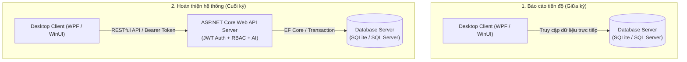

# 🏛️ KIẾN TRÚC HỆ THỐNG TECHGEAR LAPTOP STORE

> **Đồ án môn học:** Ứng dụng Quản lý 2 (UDQL2 2026) / Lập trình Desktop  
> **Sinh viên thực hiện:**  
> - 23120068: Lê Nguyễn Minh Nhật  
> - 23120069: Nguyễn Trần Quỳnh Như  
> - 23210078: Đặng Mai Quốc  
> **Chủ đề cửa hàng (Số cuối MSSV = 8):** Cửa hàng bán laptop hoặc phần cứng máy tính

---

## 📌 1. Tổng quan hai giai đoạn phát triển

Theo yêu cầu của đề cương đồ án, hệ thống được thiết kế theo mô hình Clean Architecture đa tầng, linh hoạt đáp ứng tiến độ phát triển của cả 2 mốc báo cáo:



---

## 🧱 2. Phân tầng kiến trúc (Clean Architecture)

Hệ thống được tổ chức thành 5 dự án rõ ràng, đảm bảo nguyên lý Separation of Concerns (SoC) và Dependency Inversion:

```
LaptopStore/
├── src/
│   ├── LaptopStore.Domain/         # Thực thể cốt lõi, Enums, Value Objects, Domain Exceptions
│   ├── LaptopStore.Application/    # DTOs, Service Interfaces, Logic nghiệp vụ, Validations
│   ├── LaptopStore.Infrastructure/ # EF Core DbContext, Migrations, Seed Data, Security, JWT
│   ├── LaptopStore.Api/            # ASP.NET Core Web API, Controllers, Filters, Swagger, AI API
│   └── LaptopStore.Client/         # WPF Desktop Client (MVVM, Navigation, ApiClient)
└── tests/
    └── LaptopStore.Application.Tests/ # Kiểm thử tự động (Unit Tests xUnit cho Logic, RBAC, AI)
```

### 2.1. `LaptopStore.Domain`
- Không phụ thuộc vào bất kỳ thư viện ngoài nào (Pure C#).
- Chứa các thực thể cốt lõi:
  - `Product`: Quản lý thông tin chi tiết laptop (CPU, RAM, GPU, SSD, màn hình, giá, tồn kho).
  - `Category`: Phân loại sản phẩm (Gaming, Ultrabook, Workstation, Linh kiện, Phụ kiện).
  - `Customer`: Khách hàng, mã tích lũy điểm, tổng chi tiêu.
  - `Order` & `OrderItem`: Quản lý hóa đơn mua bán, snapshot giá tại thời điểm giao dịch.
  - `User`: Tài khoản nhân viên phục vụ Authentication & RBAC.
  - `InventoryTransaction`: Lịch sử biến động xuất/nhập/điều chỉnh tồn kho.

### 2.2. `LaptopStore.Application`
- Chứa toàn bộ giao diện trừu tượng (`IProductService`, `IOrderService`, `IAuthService`, `IReportService`, `IAiAssistantService`, `IApplicationDbContext`).
- Chứa các Data Transfer Objects (DTOs) phục vụ trao đổi dữ liệu an toàn giữa Client và Server.
- Xử lý các quy tắc nghiệp vụ:
  - Kiểm tra tồn kho trước khi tạo đơn hàng.
  - Trừ tồn kho tự động trong Database Transaction.
  - Hoàn tồn kho khi đơn hàng bị hủy.
  - Ngăn chặn mua hàng số lượng âm hoặc vượt tồn kho.

### 2.3. `LaptopStore.Infrastructure`
- Hiện thực hóa `IApplicationDbContext` bằng **Entity Framework Core 8.0**.
- Hỗ trợ cả **SQLite** (chạy ngay lập tức không cần cài đặt SQL Server) và **Microsoft SQL Server** (chuyển đổi qua cấu hình `ConnectionStrings:DefaultConnection`).
- `DbInitializer`: Tự động nạp dữ liệu mẫu Demo (24 sản phẩm, 5 danh mục, 12 khách hàng, 22 đơn hàng, 4 tài khoản người dùng demo).
- `PasswordHasher`: Băm mật khẩu bằng thuật toán PBKDF2 với muối mã hóa (Salt) 100,000 vòng lặp.
- `JwtTokenGenerator`: Cấp phát JWT token kèm thông tin Role và Claims chuẩn RFC 7519.

### 2.4. `LaptopStore.Api`
- Cung cấp RESTful API đầy đủ HTTP Methods (`GET`, `POST`, `PUT`, `DELETE`).
- Xác thực bằng **JWT Bearer Token** (`[Authorize]`).
- Phân quyền theo vai trò (**RBAC**) trên từng Endpoint (`[Authorize(Roles = "...")]`).
- Tích hợp Swagger / OpenAPI với giao diện nhập token Bearer trực quan.
- Tích hợp Trợ lý AI qua endpoint `/api/ai/ask`.

### 2.5. `LaptopStore.Client`
- Ứng dụng Desktop hiện đại theo mô hình **MVVM (Model - View - ViewModel)**.
- Giao diện thân thiện, sidebar điều hướng trực quan, responsive adaptive layout.
- Hỗ trợ đổi tài khoản demo 1-click (Admin, Manager, Staff, Warehouse).
- Module AI Assistant giao diện chat trực quan, hiển thị rõ ràng các Tool mà AI đã thực thi.
