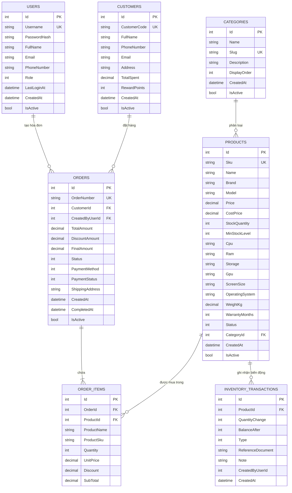

# 🗄️ THIẾT KẾ CƠ SỞ DỮ LIỆU TECHGEAR LAPTOP STORE

> **Môn học:** UDQL2 2026 / Lập trình Desktop  
> **Hệ quản trị CSDL hỗ trợ:** SQLite / Microsoft SQL Server (EF Core 8.0)

---

## 📌 1. Sơ đồ thực thể liên kết (ERD)

---

## 📋 2. Bảng mô tả chi tiết các trường dữ liệu

### 2.1. Bảng `Products` (Sản phẩm Laptop & Linh kiện)
| Tên cột | Kiểu dữ liệu | Ràng buộc | Diễn giải |
| :--- | :--- | :--- | :--- |
| `Id` | INT | PK, Auto Increment | Khóa chính |
| `Sku` | NVARCHAR(50) | UNIQUE, NOT NULL | Mã định danh sản phẩm (VD: `LAP-ROG-G16-01`) |
| `Name` | NVARCHAR(250) | NOT NULL | Tên đầy đủ của laptop / linh kiện |
| `Brand` | NVARCHAR(100) | NOT NULL | Hãng sản xuất (ASUS, Dell, Apple, Lenovo...) |
| `Model` | NVARCHAR(100) | NOT NULL | Dòng sản phẩm (Zephyrus, XPS, ThinkPad...) |
| `Price` | DECIMAL(18,2) | NOT NULL, >= 0 | Giá bán niêm yết (VNĐ) |
| `CostPrice` | DECIMAL(18,2) | NOT NULL, >= 0 | Giá vốn nhập hàng |
| `StockQuantity` | INT | NOT NULL, >= 0 | Số lượng tồn kho hiện tại |
| `MinStockLevel` | INT | DEFAULT 5 | Ngưỡng cảnh báo sắp hết hàng |
| `Cpu` | NVARCHAR(200) | NULL | Thông số CPU (VD: Intel Core Ultra 9, M3 Pro) |
| `Ram` | NVARCHAR(100) | NULL | Dung lượng và loại RAM (VD: 32GB DDR5 5600MHz) |
| `Storage` | NVARCHAR(100) | NULL | Dung lượng ổ cứng (VD: 1TB PCIe 4.0 NVMe SSD) |
| `Gpu` | NVARCHAR(150) | NULL | Card đồ họa (VD: NVIDIA RTX 4070 8GB) |
| `ScreenSize` | NVARCHAR(100) | NULL | Kích thước & công nghệ màn hình |
| `WarrantyMonths`| INT | DEFAULT 24 | Số tháng bảo hành chính hãng |
| `CategoryId` | INT | FK -> Categories(Id) | Danh mục |

### 2.2. Bảng `Orders` (Đơn hàng)
| Tên cột | Kiểu dữ liệu | Ràng buộc | Diễn giải |
| :--- | :--- | :--- | :--- |
| `Id` | INT | PK, Auto Increment | Khóa chính |
| `OrderNumber` | NVARCHAR(50) | UNIQUE, NOT NULL | Mã số hóa đơn (VD: `HD20261023-0001`) |
| `CustomerId` | INT | FK -> Customers(Id) | Mã khách hàng mua hàng |
| `CreatedByUserId` | INT | FK -> Users(Id), NULL | Nhân viên lập đơn hàng |
| `TotalAmount` | DECIMAL(18,2) | NOT NULL | Tổng tiền các món hàng trước giảm giá |
| `DiscountAmount` | DECIMAL(18,2) | DEFAULT 0 | Số tiền chiết khấu / voucher |
| `FinalAmount` | DECIMAL(18,2) | NOT NULL | Số tiền thực thu sau chiết khấu |
| `Status` | INT | NOT NULL | 1: Pending, 2: Processing, 3: Shipping, 4: Completed, 5: Cancelled |
| `PaymentMethod` | INT | NOT NULL | 1: Cash, 2: CreditCard, 3: BankTransfer, 4: Installment |
| `PaymentStatus` | INT | NOT NULL | 1: Unpaid, 2: PartiallyPaid, 3: Paid, 4: Refunded |
